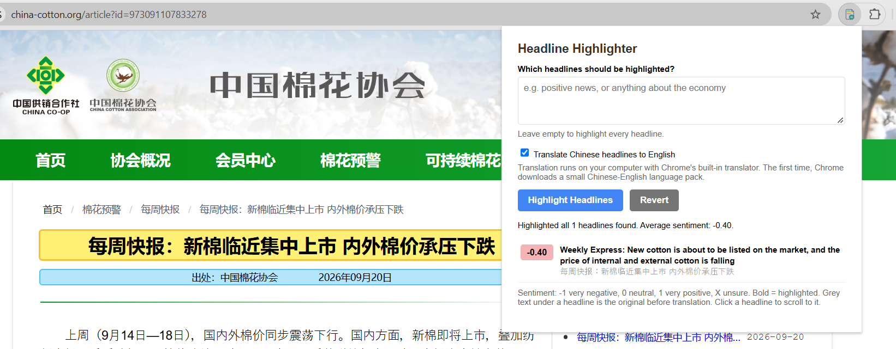

# Example sites
 - https://www.china-cotton.org/
 - https://cottonchina.org.cn/cncenew/
 - https://www.tteb.com/
 - https://www.czce.com.cn/
 - https://www.cntac.org.cn/zixun/zhengce/202609/t20260922_4421853.html

# Headline Highlighter

A Chrome extension that finds the headlines on a page, scores each one's
sentiment from **-1** (very negative) through **0** (neutral) to **+1** (very
positive), or **X** when unsure, and highlights the ones that match a
description you type, such as "positive news" or "anything about the economy".

Everything runs on your computer using Chrome's built-in **Gemini Nano** model
(the Prompt API). No API key is needed and nothing is sent to a server.

It can also translate Chinese headlines into English first, using Chrome's
built-in **Translator API**. This also runs on your computer.

## Example


## RAM 
This is a pretty hungery application - two of the models each weight in at 4 gig each. 

### Install a Chrome extension

1. Go to `chrome://extensions`.
2. Turn on **Developer mode** (top right).
3. Click **Load unpacked** and select this folder.
4. Pin the extension from the puzzle-piece menu in the toolbar.

## Use

1. Open a news page, for example a newspaper's front page.
2. Click the extension icon.
3. Optionally type which headlines you want highlighted. Leave the box empty
   to highlight every headline.
4. For Chinese news sites, tick **Translate Chinese headlines to English**.
   The setting is remembered.
5. Click **Highlight Headlines**.
   - Matching headlines are highlighted in **yellow** on the page, and their
     story text in **light blue**.
   - The popup lists every headline with its sentiment score. Bold rows are the
     highlighted ones. Click a row to scroll to that headline.
   - Translated headlines show in English, with the original Chinese in grey
     underneath. The page itself isn't changed.
6. To highlight something yourself, select text on the page, open the popup
   and click **Highlight Selection**. The text turns **orange**, and it's
   translated (if turned on) and scored like a headline. Re-running
   **Highlight Headlines** keeps your highlights.
   - Each one is saved under **Your highlights** in the popup, newest first,
     with its score, the page it came from and when. The list is kept between
     popup openings and across pages (up to 500 entries).
   - **Copy History** copies the whole list as plain text, ready to paste
     into notes or an email. **Clear History** empties it. Neither changes
     the highlights on the page.
7. Click **Revert** to remove all highlights, including your own.

## How it works

- **What counts as a headline:** `content.js` looks at `h1`–`h4` tags and
  elements marked as headlines (`itemprop="headline"`, or "headline" in the
  class name). It skips menus and footers, hidden elements, duplicates, and
  very short labels. A headline must also have **associated text**: the
  content that follows it, up to the next headline, has to include at least 5
  words that aren't links. This filters out menus and page headers.
- **Scoring:** `popup.js` sends the headlines to Gemini Nano 10 at a time,
  each with the first 250 characters of its story text. The model must reply
  in a fixed JSON format with a sentiment score, an "unsure" flag (shown as X)
  and a match decision for each headline. Results appear in the popup as each
  group finishes.
- **Chinese:** Chinese doesn't use spaces between words, so `content.js`
  counts each Chinese or Japanese character as a word when deciding what's
  long enough to be a headline. Gemini Nano only supports English, Spanish and
  Japanese, so when translation is on, any headline or snippet containing
  Chinese characters (and no Japanese kana) is first translated by Chrome's
  [Translator API](https://developer.chrome.com/docs/ai/translator-api)
  (`zh` → `en`). It uses a separate translation model, not Gemini Nano. Chrome
  downloads the language pack once, after which translation works offline.
  The English text is then scored as usual.

# Nothing is happening?

The usual cause is that the Gemini Nano model hasn't been downloaded yet.
Chrome doesn't download it in advance. It only starts when a page or
extension asks for the model after you click something, and sometimes it
doesn't start at all until you force it.

## 1. Check whether the model is downloaded

Go to `chrome://on-device-internals`, open the **Broker State** tab, and look
at the **Models** table.

- **A real Folder Size and a Weights Path** means it's downloaded. Skip to
  step 4.
- **Every model showing `0 MiB` with no weights path** means nothing has been
  downloaded. Carry on with step 2.

The **Event Logs** tab only records events while it's open. Keep it open in
one tab while you try things in another.

## 2. Turn on the flags

Go to `chrome://flags`, set these, then click **Relaunch**:

| Flag | Setting |
| --- | --- |
| `#optimization-guide-on-device-model` | Enabled BypassPerfRequirement |
| `#prompt-api-for-gemini-nano` | Enabled |
| `#summarization-api-for-gemini-nano` | Enabled |

## 3. Force the download ( I needed to do this ) 

Open the browser console on any normal web page: open a site such as a news
page (not a `chrome://` page), press **F12**, and go to the **Console** tab.
Then drop this in:

```js
document.addEventListener("click", async () => {
  console.log("Availability:", await LanguageModel.availability());
  const s = await LanguageModel.create({
    monitor(m) {
      m.addEventListener("downloadprogress", (e) =>
        console.log(`Downloaded ${Math.round(e.loaded * 100)}%`)
      );
    },
  });
  console.log("Model ready!", s);
}, { once: true });
```

Then **click anywhere on the page**. Chrome only starts the download after a
real click, and typing in the console doesn't count, which is why the code
waits for one.

- If Chrome won't let you paste, type `allow pasting`, press Enter, and paste
  again.
- The console prints the availability, then download percentages, then
  "Model ready!". The download is several GB, so leave Chrome open until it
  finishes. You can also watch the **Folder Size** grow on the **Broker
  State** tab (refresh the page to update it).

Alternatively, go to `chrome://components`, find **Optimization Guide On
Device Model**, and click **Check for update**.

## 4. Reload and try again

Once the model has downloaded, reload the extension at `chrome://extensions`,
reload the page, and click **Highlight Headlines**.

## What the messages mean

| Message | Meaning |
| --- | --- |
| `"available"` | The model is ready. |
| `"downloadable"` | The model isn't downloaded yet. Chrome will fetch it once something asks for it after a click (see step 3). |
| `"downloading"` | The download is in progress. Wait and check the Broker State tab. |
| `"unavailable"` | Chrome won't run the model on this device. Check disk space, the flags in step 2, and `chrome://policy` for admin policies. |
| `LanguageModel is not defined` | The Prompt API isn't switched on. Check the flags in step 2 and your Chrome version. |
| "No headlines found on this page." | The model is fine, but no headlines with associated text were found on this page. |

To see detailed errors from the extension itself, right-click inside the
popup, choose **Inspect**, and open the **Console** tab.
